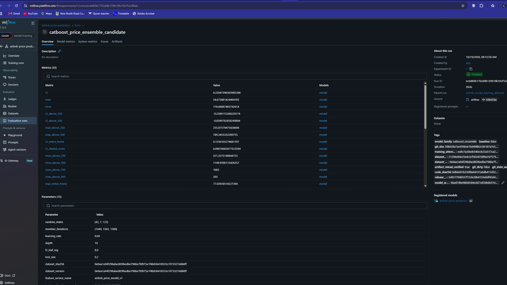

# Pricing ML Platform

## Overview

This is a production ML platform for New York City Airbnb price predictions.
It connects feature management, experiment tracking, governed deployment,
rollback, and monitoring so teams can move models from research into a reliable
customer-facing service.

The business value is safer releases, faster issue detection and recovery, and
traceable model decisions. For the team, it provides one repeatable workflow
that data scientists, engineers, and operators can share and run confidently.

## Platform demo

See the platform flow from training evidence to a controlled production
prediction.

https://github.com/user-attachments/assets/300feb1d-6ac5-449f-8c45-eb080d920a61

For the end-to-end explanation of how a model moves from training to
production, including the promotion, rollback, and retraining loop, see the
[model lifecycle section](docs/ARCHITECTURE.md#model-lifecycle-training-to-production).
The [prediction API documentation](docs/ARCHITECTURE.md#prediction-api)
describes the serving endpoints, request contract, responses, and error
statuses.

## Evidence and demos

| Deployment control | Experiment evidence | Monitoring evidence |
|---|---|---|
|  |  |  |
| Healthy, synced applications make releases safer and recovery faster. | Recorded metrics, lineage, and versioning make model decisions auditable. | Successful scheduled checks surface issues before they affect users. |

### Video demos

| Demo | Focus | Business outcome |
|---|---|---|
| Platform walkthrough | Training, approval, release, and serving | Shows how a governed model becomes a production prediction. |
| Grafana dashboards | Service health, latency, capacity, drift, and quality | Gives operators one view for fast, evidence-based action. |
| [Load-testing walkthrough](https://github.com/user-attachments/assets/c6ad3cd4-327e-4fe3-8132-602e1ecc0327) | k6 baseline traffic and autoscaling response | Shows how serving capacity and latency behave under sustained load. |

#### Grafana dashboards

See service health, latency, capacity, drift, and model quality in one view.

https://github.com/user-attachments/assets/5f17e3db-6a54-43fc-8e81-f1077c602f9e

## Design documentation

| Document | Key knowledge | Business value |
|---|---|---|
| [Architecture](docs/ARCHITECTURE.md) | Model lifecycle, promotion gates, rollback, and prediction API | Releases are controlled and recoverable. |
| [Infrastructure](docs/INFRASTRUCTURE.md) | AWS rebuild model, node pools, monitoring, and operational controls | The platform can scale and be operated reliably. |
| [Problem and model evidence](docs/PROBLEM.md) | Business objective, data scope, metrics, experiments, and limitations | Model decisions are measurable and transparent. |

## Tradeoffs and lessons learned

The dataset limited how far the model could be optimised, so I prioritised
reliable scaling, observability, and rollback over marginal model gains. Dedicated
on-demand capacity and highly available services improved resilience, but added
cost and operational complexity. I learned that models can drift or fail under
load, making it essential to validate weights, features, and serving behaviour at
scale. DevOps practices made each ML lifecycle stage observable, recoverable, and
safe to roll back.

## 1. Prerequisites — tools and accounts

For local development, install Git, Docker with Compose, Python 3.10+, and
[uv](https://docs.astral.sh/uv/). For AWS deployment, you also need an AWS
account with permission to create the required infrastructure, the AWS CLI,
Terraform, `kubectl`, and Helm. GitHub Actions deployment requires repository
Actions permissions plus the configured AWS OIDC, ECR, and production
environment variables.

## 2. Quick start — deploy from a fresh clone

```sh
git clone https://github.com/isaiah1701/pricing-ml-platform.git
cd pricing-ml-platform
uv sync --extra test --extra orchestration
scripts/compose.sh up --build --detach
```

This starts the local platform. Validate it with `uv run pytest`. Production
deployment is performed through the Terraform and GitHub Actions workflows
after AWS credentials, repository variables, and the production environment
have been configured.
