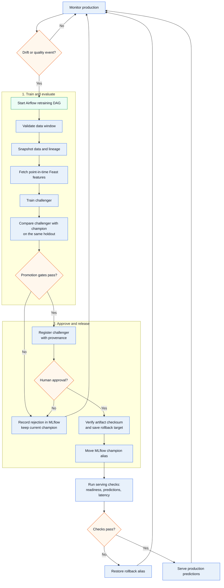

# Architecture

## Model lifecycle: training to production

The platform treats a model release as a governed lifecycle rather than a
single deployment step. A retraining event starts an Airflow DAG, which first
validates and snapshots the production data window. Training then retrieves
point-in-time-correct features from Feast and evaluates a challenger against
the current production champion on the same deterministic holdout.

Only a challenger that satisfies the promotion gates is registered in MLflow.
Those gates require a meaningful MAE improvement and prevent unacceptable
regressions in RMSE and key segments. A human approval is required before the
MLflow `champion` alias moves. The serving deployment resolves that alias, and
post-promotion checks verify readiness, model identity, predictions, and
latency. If verification fails, the saved `rollback` alias is restored.

After a successful release, prediction events and model-quality metrics are
kept for operational monitoring. Drift or quality degradation produces the
next retraining event, closing the feedback loop.


This evidence lets reviewers trace a production candidate back to its measured
results, training settings, and registered version.

## Prediction API

The serving application exposes a small FastAPI contract around the MLflow
`champion` model. Interactive OpenAPI documentation is available at `/docs`
when the service is running.

| Method and route | Purpose | Success |
|---|---|---|
| `GET /health` | Process liveness; does not call MLflow. | `200` with `{"status":"ok"}` |
| `GET /ready` | Confirms that the aliased model is loaded. | `200` with model, alias, and version; `503` if unavailable |
| `POST /predict` | Validates one engineered listing and returns its nightly-price prediction. | `200` with prediction ID, timestamp, price, and model identity |
| `GET /metrics` | Prometheus metrics for scraping. | Prometheus text payload |

`POST /predict` accepts JSON matching `ListingFeatures`. It requires the
listing location, room type, minimum nights, review and availability values,
and the derived bands/cells used by the fitted feature schema. Extra fields are
rejected. Validation failures return FastAPI's `422` response; an unavailable
model or saturated prediction queue returns `503`; unexpected inference
failures return a generic `500` response without exposing model or credential
details.

Example response:

```json
{
  "prediction_id": "8c6e1d3b-3f7c-4a41-9fb7-4e2cb3b8f1f4",
  "prediction_timestamp": "2026-10-19T12:00:00+00:00",
  "predicted_price": 142.75,
  "model_name": "airbnb-price-predictor",
  "model_alias": "champion",
  "model_version": "12"
}
```

Successful predictions include an `X-Trace-Id` response header when tracing is
enabled. Prediction events are persisted for monitoring when production event
storage is configured.



### Lifecycle responsibilities

1. **Train reproducibly.** The training run records the code revision, dataset
   snapshot, feature service, holdout configuration, metrics, and model
   artifact checksum in MLflow.
2. **Compare before release.** The challenger is compared with the current
   champion using identical evaluation data. Failed gates are recorded and do
   not affect production.
3. **Promote safely.** A passing challenger receives provenance tags, waits for
   explicit approval, and is promoted by changing the MLflow alias rather than
   copying model files into the serving image.
4. **Verify and recover.** Serving checks confirm that the intended version is
   live. A failed check triggers an automatic rollback to the previously
   verified alias target.
5. **Observe and repeat.** Prediction events, operational metrics, drift, and
   model quality determine whether another training cycle is needed.
