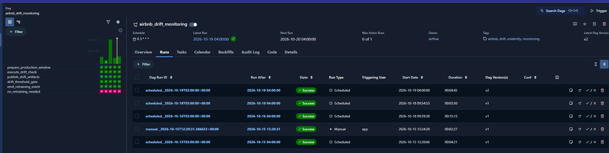
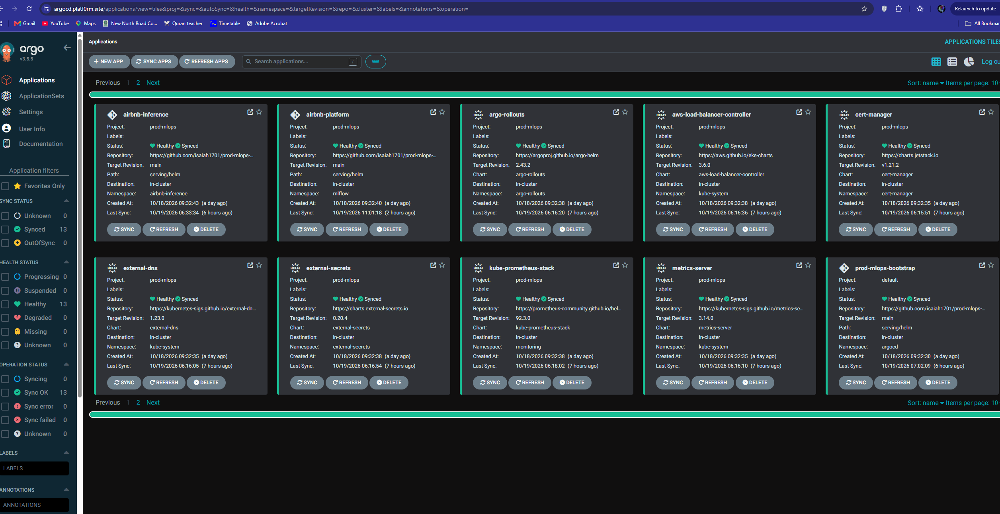

# AWS infrastructure

The platform is split into reusable Terraform modules and environment roots.
Only `terraform/environments/prod` is active; dev and staging are retained as
placeholders.

- `terraform/modules/ecr` creates immutable, scan-on-push image repositories. The environment creates one repository for the serving image and one for the training image.
- `terraform/modules/vpc` creates two-AZ public/private networking, NAT gateways, Kubernetes subnet tags, an S3 gateway endpoint, and private ECR, STS, and CloudWatch Logs endpoints.
- `terraform/modules/eks` creates an encrypted EKS cluster with audit logs, an EBS CSI driver role, explicit API access entries, and three managed node pools.
- `terraform/modules/route-53` creates or reuses the `platf0rm.site` hosted zone. ExternalDNS owns the apex NLB record; Kubernetes cert-manager issues and renews the HTTPS certificate used by Traefik.
- `terraform/modules/rds`, `terraform/modules/redis`, and `terraform/modules/s3` provide separate MLflow/Airflow PostgreSQL stores, the Feast online store, and Object-Locked platform artifacts.

## Rebuild inventory

Destroying EKS is safe only when the durable control and data planes remain.
The separate bootstrap S3 bucket retains Terraform state. The Object-Locked
platform bucket retains these rebuild inputs:

- `data/`: original source datasets needed to recreate transformations;
- `snapshots/`: immutable feature snapshots and lineage documents;
- `mlflow/`: model artifacts (the MLflow registry metadata remains in RDS);
- `production/events/`: immutable prediction events used for drift windows;
- `monitoring/`: persisted drift and model-quality reports; and
- `recovery/platform-manifest.json`: the non-secret inventory and expected prefixes.

Git remains the source for Terraform, Helm, Airflow DAGs, and dashboards; ECR
retains immutable serving/training images; Secrets Manager retains credentials.
Restore MLflow and Airflow metadata from RDS snapshots before bootstrapping the
applications. Redis is derived state and is repopulated from the immutable
feature snapshot. Do not treat S3 model artifacts alone as a registry backup.

## Node-pool contract

The `system` pool hosts EKS add-ons. The `serving` and `training` pools are deliberately separate and tainted. A serving Deployment must select `workload=serving` and tolerate `workload=serving:NoSchedule`; a training Job must use the equivalent `training` selector and toleration. This prevents scheduled retraining workloads from consuming serving capacity.

Training defaults to CPU instances because this platform uses tabular models.
Production keeps one on-demand training node for Airflow's LocalExecutor and its
control-plane components; the dev/staging placeholders may scale to zero. The
Cluster Autoscaler discovers the underlying Auto Scaling groups through explicit
Terraform-managed tags. Training work stays off the serving pool. A GPU pool can
be added later if the model needs it.

## Monitoring and observability architecture

Monitoring is a production control system, not only a set of operational
dashboards. Its purpose is to give engineering and business owners early,
actionable evidence that the platform is available, that predictions are
useful, and that automated decisions remain safe to operate.

### What is monitored

| Area | Business question | Signals and evidence |
| --- | --- | --- |
| Customer-facing inference | Can customers obtain a prediction within the expected service level? | Request volume, latency, errors, readiness, and deployed model version |
| Model behaviour | Is the model still accurate and useful in the current market? | Feature/prediction drift; delayed MAE, RMSE, R², bias, coverage, and tolerance measures |
| Training and data pipelines | Can a regression be traced to its source and corrected safely? | Airflow success/failure/freshness, data quality, drift, retraining events, and MLflow lineage |
| Platform servers and capacity | Is infrastructure reliable, and is serving protected from batch workloads? | EKS node, workload, storage, and capacity metrics across separate system, serving, and training pools |

Every prediction carries its deployed model version. Prediction events are
retained in Object-Locked S3 so production behaviour can be investigated and
quality can be measured once ground-truth outcomes arrive.

### Monitoring components

| Component | Role | Operational value |
| --- | --- | --- |
| Prometheus | Collects metrics and evaluates alert conditions; ServiceMonitor resources discover serving workloads | Detects availability, latency, capacity, pipeline, drift, and quality problems |
| Grafana | Presents provisioned dashboards backed by Prometheus | Gives operators and leadership a shared view of service health and model risk |
| Alertmanager + SNS | Routes actionable alerts to the on-call path | Reduces time to detect and respond without requiring dashboard polling |
| Airflow monitoring jobs | Publishes pipeline, drift, and delayed model-quality results | Shows whether data and scheduled controls are running and producing fresh evidence |
| MLflow | Stores experiments, parameters, metrics, artifacts, and model lineage | Explains which candidate, dataset, and code produced a deployed model |
| S3 | Retains prediction events, drift windows, quality reports, and recovery metadata | Provides durable evidence for investigations and rebuilds |
| RDS | Retains MLflow and Airflow control-plane metadata | Preserves workflow and registry history independently of compute |
| EKS and kube-prometheus-stack | Monitors nodes, workloads, storage, and platform services | Makes infrastructure degradation and resource contention visible |



The scheduled run history gives the team simple evidence that monitoring is
fresh and working, rather than relying on a dashboard alone.

### Business controls and response

| Decision | Primary indicators | Response |
| --- | --- | --- |
| Can customers use the service? | Availability, error rate, latency, and readiness | Protect the prediction experience and investigate customer impact |
| Is the platform operating reliably? | Pipeline failures, stale checks, capacity pressure, and missing telemetry | Restore the control loop before it becomes an incident |
| Is the data still representative? | Drift and data-quality thresholds | Investigate input or market changes before trusting new decisions |
| Is the model still delivering value? | Delayed production quality versus the configured reference | Hold, investigate, retrain, or promote through the governed process |

Alerts are evidence for an operator decision, not an automatic licence to
promote a model. Canary analysis, immutable image digests, GitOps review, and
the existing model-promotion safeguards remain the change controls. A failed
or stale monitor therefore causes investigation or a hold, rather than being
silently treated as a healthy result.

This creates a clear chain from business risk to technical signal: customer
impact is observed at the API, model risk is measured against outcomes, and
infrastructure risk is tied to the servers and workflows supporting both. It
also keeps monitoring costs predictable by using the existing EKS,
Prometheus/Grafana, SNS, S3, RDS, and MLflow services.

### Load-testing evidence

The inference service is exercised with the repository's k6 scenarios while
Grafana tracks throughput, latency, errors, replicas, and node capacity. The
[load-testing walkthrough](https://github.com/user-attachments/assets/baff8398-9597-4f9f-891f-46a1b64b5808)
shows the baseline run and autoscaling response.

## State and deployment



This deployment view gives operators a fast answer to the key release question:
which platform services are live, healthy, and aligned with the approved state.

The production environment has an empty S3 backend block. Bootstrap the
encrypted state bucket once, then use native S3 lock files without hard-coding
account-specific names:

```sh
cd terraform/environments/prod
../../../scripts/terraform.sh init \
  -backend-config="bucket=<terraform-state-bucket>" \
  -backend-config="key=prod-mlops/prod/terraform.tfstate" \
  -backend-config="region=eu-west-2" \
  -backend-config="encrypt=true" \
  -backend-config="use_lockfile=true"
../../../scripts/terraform.sh plan
```

The wrapper configures a user-level provider cache. This avoids storing another
copy of the approximately 800 MB AWS provider in every Terraform root module.

Use `terraform/environments/prod/terraform.tfvars.example` as the reviewed
input template. If `platform_admin_principal_arn` is left unset, the Terraform
caller receives the initial EKS administrator entry. The cluster API is private
by default; enable public access only with a restricted CIDR allow-list during
bootstrap.
